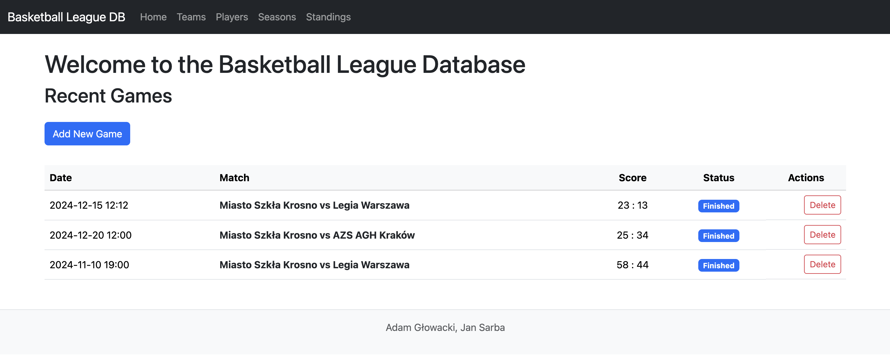
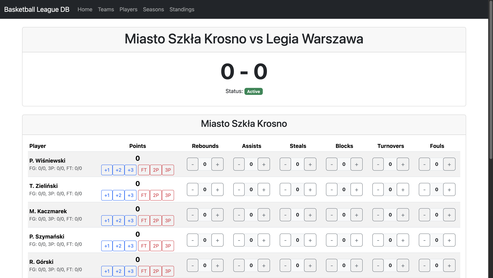
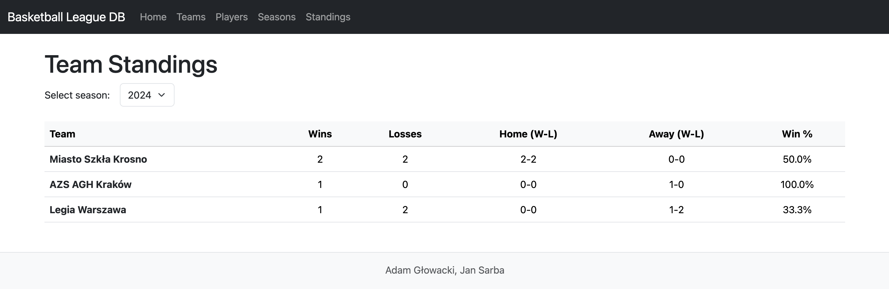

# Basketball-League-Database

Adam Głowacki
Jan Sarba

---

A comprehensive web application for managing a basketball league. The system allows for full CRUD management of teams, players, and seasons. It features game scheduling, live game statistics tracking, and automatically updated league standings.

## Features

-   **Team & Player Management**: Full CRUD operations for teams and players, including player details like position, physical attributes, and team assignment.
-   **Season & Game Scheduling**: Create seasons and schedule games between teams.



-   **Live Game Statistics**: An interactive interface to track and update player statistics (points, rebounds, assists, etc.) in real-time during an active game.



-   **Dynamic Standings**: League standings are automatically calculated and displayed, updating after each completed game.



-   **Player Career Tracking**: View a player's statistics and team history across multiple seasons.
-   **Data Integrity**: Robust validation and database constraints to ensure logical and consistent data (e.g., a team cannot play against itself).

## Tech Stack

-   **Backend**: Java 21, Spring Boot 3, Spring MVC, Spring Data JPA
-   **Database**: Oracle Database (with Oracle JDBC Driver)
-   **ORM**: Hibernate
-   **Frontend**: Thymeleaf, Bootstrap 5
-   **Build Tool**: Maven
-   **Validation**: Jakarta Bean Validation (used for entity and request validation)

## Key Concepts & Best Practices Implemented

This project demonstrates several key software engineering principles and modern development practices:

-   **Layered MVC Architecture**: A clear separation of concerns with a well-defined structure:
    -   `@Controller` for handling web requests and UI interaction.
    -   `@Service` for encapsulating all business logic.
    -   `@Repository` (Spring Data JPA) for the data access layer.
-   **Optimistic Locking**: The use of `@Version` on entities (like `Player` and `Game`) to prevent data corruption from concurrent updates. The application gracefully handles `ObjectOptimisticLockingFailureException` to inform the user about the conflict.
-   **Transactional Integrity**: `@Transactional` annotation is used on service methods to ensure that complex operations (e.g., finishing a game and updating two team records) are atomic. If any part of the operation fails, the entire transaction is rolled back, maintaining data consistency.
-   **Advanced JPA/Hibernate Mappings**:
    -   Effective use of relationships (`@ManyToOne`, `@OneToMany`) with proper cascade types (`CascadeType.REMOVE`).
    -   Database-level constraints using Hibernate's `@Check` annotation to enforce business rules directly in the DDL (e.g., `HOME_TEAM_ID != AWAY_TEAM_ID`).
    -   Composite keys implemented via a separate ID class (`PlayerStatsViewId`) for views or complex join tables.
    -   Custom Oracle `SequenceGenerator` for primary key generation.
-   **Modular Frontend with Thymeleaf**: The user interface is built with reusable components using Thymeleaf Fragments (`th:replace`, `th:fragment`), leading to clean and maintainable HTML code.
-   **Complex Business Logic in Services**: The service layer contains non-trivial logic, such as:
    -   Dynamically creating `GameStats` entries when a game starts.
    -   Calculating game winners and updating team records upon game completion.
    -   Reversing team record changes when a game is deleted.
    -   Managing player team history when a player is reassigned.

## How to Run

1.  **Configure Database**: Ensure you have an Oracle Database instance running. Update the connection details in `application.properties`.
2.  **Build the Project**:
    ```bash
    mvn clean install
    ```
3.  **Run the Application**:
    ```bash
    mvn spring-boot:run
    ```
4.  The application will be available at `http://localhost:8080`.